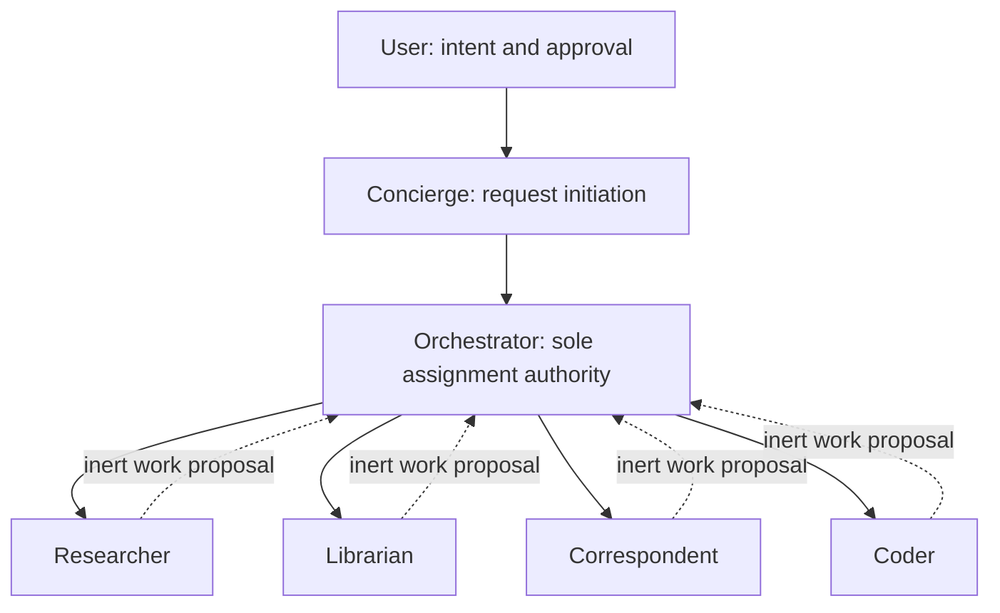
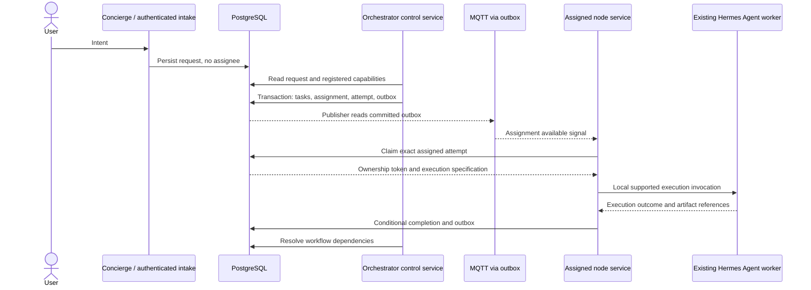
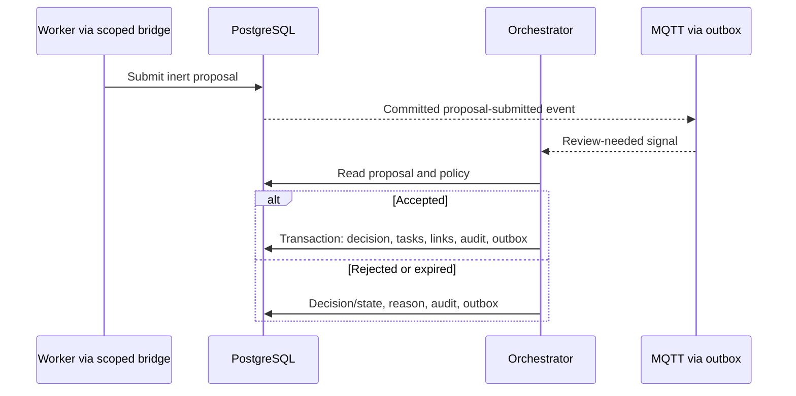

# Hermes Multi-Agent Coordination Layer

**Architecture v1.0**

Status: Approved

Date: 2026-10-14

This document is the frozen implementation baseline. Architectural changes require a new version and explicit approval.

Engineering architecture and phased implementation plan.

## 1. Purpose And Scope

**Hermes Agent is the execution engine.**

**Hermes Multi-Agent Coordination Layer is distributed coordination infrastructure.**

The Coordination Layer is a Python-based system providing PostgreSQL-based coordination, MQTT notification and signaling, task orchestration, workflow management, agent registration, assignment ownership, monitoring, approval workflows, artifact tracking, and fleet management.

This project is not an agent framework. It does not implement agents, skills, reasoning loops, memory systems, prompts, tool routing, or model execution. Existing Hermes Agent installations own those functions. Concierge, Orchestrator, Researcher, Librarian, Correspondent, and Coder refer to existing Hermes Agent identities/profiles, not classes implemented here.

PostgreSQL is the system of record for coordination state. MQTT signals that durable state has changed; it is neither a task queue of record nor an assignment authority. Agents never communicate directly, invoke peers, or deliver executable work to one another.

### Deployment Context

| Host | Responsibility | Phase |
| --- | --- | --- |
| Rpi1 | Hermes Agent instances, node coordination service, initially the single Orchestrator control service | 1 |
| Rpi2 | Hermes Agent instances and node coordination service | 1 |
| Rpi6 | PostgreSQL coordination database | 1 |
| Rpi7 | MQTT broker and n8n request/notification integration | 1 |
| Rpi3 | Future Honcho service, integrated through existing Hermes Agent support | 2 |
| Rpi5 | Ollama embeddings consumed through existing execution integrations | 2 |
| Rpi8 | Grafana, Prometheus, and Loki | 2 |
| N150 | Playwright MCP, Crawl4AI, and SearXNG tool services | 2 |

These placements are initial deployment choices. Agent contracts contain no hostname, and compatible agents may run on any authorized host. Shared tool services are not worker peers. Their execution integration belongs to Hermes Agent, not this project.

### Architectural Invariants

- Only the Orchestrator control service can create executable assignments or select an assignee.
- Every assignment, attempt, accepted result, proposal decision, and approval decision has a durable PostgreSQL record.
- Notifications may be lost, duplicated, or reordered without changing correctness.
- Workers execute only their current assigned attempt and can submit proposals, not assignments.
- Accepted artifact bytes are external to PostgreSQL and immutable; PostgreSQL stores their metadata and provenance.
- Sensitive actions require an explicit, durable user approval bound to the exact proposed action.
- Retrying computation is different from retrying an external effect. An unknown effect outcome is reconciled, not blindly replayed.

## 2. Authority Model

### Formal Authority Chain



The hierarchy describes decision authority, not a direct communication transport. All cross-agent handoffs are PostgreSQL records and MQTT signals. The User approves sensitive actions; Concierge initiates requests; Orchestrator creates tasks and assigns eligible workers.

Separate the existing Orchestrator Agent's planning output from the privileged Orchestrator control service. The Agent recommends a plan through a durable record. The service validates policy, capabilities, dependencies, budgets, and approvals before committing it. They constitute one logical Orchestrator authority; model output alone never authorizes a mutation.

Intake may persist user input and the Orchestrator may assign Concierge an intake task. Concierge then records the request for worker execution. This bootstrap does not give Concierge assignment privileges. n8n and dashboards act as authenticated user-facing clients, not additional schedulers.

### Permission Boundaries

| Principal | Permitted | Forbidden |
| --- | --- | --- |
| User | Submit intent, view authorized state, decide approvals, request cancellation/retry | Direct assignment-table mutation |
| Concierge | Initiate requests, clarify recorded intent, read authorized request state | Assign tasks, invoke workers |
| Orchestrator control service | Validate plans/proposals, create tasks and dependencies, assign, reconcile, schedule retries | Self-approve sensitive actions or override rejected user decisions |
| Researcher, Librarian, Correspondent, Coder | Execute assigned work, report scoped progress/results, register artifacts, submit proposals | Assign tasks, invoke peers, create executable assignments |
| Node service | Register instances, claim assigned attempts, renew ownership, collect execution outcomes | Select assignees, create follow-up executable work |
| Outbox publisher | Read/lease outbox rows and publish notifications | Schedule tasks or approve actions |
| Dashboard/n8n | Submit authorized requests and approval decisions through services | Become an assignment authority |

Use distinct PostgreSQL roles for intake, Orchestrator, node operations, approval decisions, outbox publishing, and reporting. Revoke public table writes. The Orchestrator role alone can insert assignments and mutate assignee/readiness/retry fields. Node writes use restricted transactional operations that verify authenticated node, agent incarnation, attempt ownership, and allowed transitions. Worker-facing bridges have no unrestricted SQL operation.

Schema constraints enforce referential integrity, transition prerequisites, and uniqueness; privileges and restricted database operations enforce the identity performing the change. Service authorization repeats these checks. Agent output must never supply its own trusted principal, approval identity, or ownership token.

Keep database/broker credentials out of agent execution environments. The node service holds credentials outside the agent sandbox and mediates narrowly scoped operations. Disable or exclude Hermes Agent peer messaging, delegation, shared bot-chat invocation, autonomous kanban dispatch, and independent scheduled work for managed workloads. Enforce isolation and network restrictions so shell access cannot bypass those exclusions.

### Request And Assignment Sequence



## 3. Package Structure And Service Contracts

The proposed Python import namespace is `hermes_coordination`; the distribution name is `hermes-multi-agent-coordination-layer`. Renaming the remote repository or local workspace directory is a separate administrative operation.

| Package | Responsibility |
| --- | --- |
| `hermes_coordination.contracts` | Versioned coordination records and validation schemas |
| `hermes_coordination.intake` | Authenticated request submission and idempotency |
| `hermes_coordination.control` | Assignment authority, capability scheduling, dependencies, retries, reconciliation |
| `hermes_coordination.registry` | Agent/node identities, incarnations, registration, capability inventory |
| `hermes_coordination.node` | Assignment discovery, ownership renewal, process supervision, result collection |
| `hermes_coordination.adapters.hermes_agent` | Narrow, version-pinned external invocation/output adapter |
| `hermes_coordination.proposals` | Inert proposal submission, review validation, decision history |
| `hermes_coordination.approvals` | Action-bound approval requests, decisions, policy checks |
| `hermes_coordination.artifacts` | Metadata, provenance, provider abstraction, acceptance, retention |
| `hermes_coordination.storage` | PostgreSQL transactions, repositories, migrations |
| `hermes_coordination.messaging` | MQTT envelopes, outbox delivery, reconnect/polling |
| `hermes_coordination.api` | Operational API and optional restricted coordination MCP bridge |
| `hermes_coordination.observability` | Metrics, structured logs, health, correlation |
| `hermes_coordination.config` and `hermes_coordination.cli` | Validated deployment configuration and administration |

Use composition rather than an agent class hierarchy. `OrchestratorService` composes `AssignmentService`, `CapabilityMatcher`, `WorkflowValidator`, and `Reconciler`. `NodeService` composes `RegistrationService`, `AssignmentWatcher`, `OwnershipManager`, `HermesAgentAdapter`, and `ResultCollector`. `ProposalService`, `ApprovalService`, and `ArtifactService` own their respective coordination records.

`HermesAgentAdapter` is not a harness: it invokes a supported upstream interface, observes execution, and maps outcomes. It does not implement prompts, tool execution, skills, provider fallback, or conversation logic. Pin the installed Hermes Agent version and contract-test its supported one-shot/structured-output interface. Unsupported cancellation or approval capabilities must fail deployment validation rather than be assumed.

### Approved Phase 1 Invocation Decision

**Select local CLI invocation: one supervised Hermes Agent one-shot process per assigned attempt.** Do not use peer APIs, an embedded agent library, or a persistent conversational server for Phase 1 execution.

| Option | Evaluation | Decision |
| --- | --- | --- |
| CLI invocation | Documented one-shot and structured output; separate process/dependency environment; observable exit and OS-level cancellation; some process startup overhead | Phase 1 default |
| API invocation | Can support persistent execution, but adds server lifecycle, authentication, request/run ownership, and remote cancellation semantics to verify for the installed release | Defer; not required for local node execution |
| Embedded library invocation | Avoids process startup but couples the Node Service to upstream Python dependencies/internal APIs and makes crash containment and cancellation harder | Not selected |

The adapter uses the pinned executable, explicit `--profile`, `chat --oneshot`, `--query-file`, and `--format stream-json`. Pass an argument vector without a shell; deliver the assigned input through a protected file, not command-line interpolation. Do not use the legacy runner, plain-text `-z` output, implicit default profiles, or `latest` session resume. Hermes owns all execution behavior; the adapter supplies the assigned task input without constructing a reasoning framework.

1. Verify assignment ownership, profile/version compatibility, endpoint configuration, and the isolated attempt workspace. Record an execution run before starting the child so launch failures are attributable.
2. Launch without a TTY in a dedicated Linux execution containment scope, using an OS supervisor/cgroup whose lifecycle is tied to the Node Service. Record the scope identity as well as the PID; an unmanaged process group alone is not sufficient to contain detached descendants. Keep coordination credentials and protected host mounts outside the execution scope.
3. Drain stdout and stderr concurrently with bounded buffering. Parse stdout as JSONL; associate `system/init` and terminal `result` records with the task/attempt and Hermes session ID. Collect progress without interpreting it as assignment authority. Renew the database lease independently of output activity.
4. Wait for the terminal result, process exit, and execution-scope cleanup. Accept success only when result/exit status agree, the task output contract validates, required artifacts are durably accepted, and ownership remains current. Missing/malformed terminal output or leftover uncontained work is not success.
5. Commit the conditional outcome and outbox event, preserve required telemetry/artifacts, and clean up ephemeral workspace contents. Retries create a new attempt/process; the Node Service never automatically reruns a crashed child under the same attempt.

**Cancellation:** On durable cancellation or impending ownership loss, stop effect authorization and send SIGINT to the exact attempt scope. Allow 10 seconds for cooperative exit, then SIGTERM with a 5-second grace, then SIGKILL to remaining local descendants. These are Node Service policy defaults, not promises about upstream cancellation. Reap processes and record the stop reason even if no terminal result was emitted. Remote tool sessions require their existing integration's verified cleanup; uncertain remote effects remain blocked for reconciliation. A node restart stops/reconciles surviving scopes before accepting new work.

**Timeouts:** Phase 1 defaults are 60 seconds to receive initialization and 15 minutes total wall-clock execution, configurable by authorized task policy and bounded by the task deadline. Use monotonic elapsed time, not log activity, for timeout enforcement. `--max-turns` is an additional configured upstream iteration limit, not a wall-clock timeout. Reserve the shutdown grace plus a safety margin before the current lease expires; shorten/skip cooperative grace when ownership safety requires immediate containment. A timeout uses the same stop sequence and records `deadline_exceeded`, not user cancellation. The Orchestrator decides retry eligibility.

**Telemetry:** Store bounded execution summaries, timestamps, terminal status, stop reason, session/profile identity, adapter/Hermes version, and exposed token/duration counters in PostgreSQL. Redact tool inputs/results and stderr; raw retained execution traces are NAS artifacts, not database blobs. Record unavailable cost/auxiliary counters as unavailable rather than fabricating a complete usage total. Never infer success from nonempty output.

**Upgrades:** Pin a tested Hermes release/commit and adapter compatibility revision. Drain an instance before upgrading; retain the prior executable/environment and profile backup for rollback. Contract-test invocation flags, JSONL events, initialization failure, iteration exhaustion, interruption, descendant cleanup, and approval fail-closed behavior on each candidate version. Re-register changed versions/capability inventories and canary on one node before fleet rollout. No unattended upstream update during active attempts.

## 4. Agent And Node Identity

| Concept | Stable identifier | Meaning |
| --- | --- | --- |
| Agent Identity | UUID plus unique display name, e.g. `researcher-01` | Logical authorized worker/profile, independent of host |
| Node Identity | UUID plus unique display name, e.g. `rpi1` | Authorized machine or deployment host |
| Agent Instance | New UUID per activation/incarnation | A particular agent running on a particular node |
| Profile Revision | Approved digest/revision | External Hermes configuration deployed for the identity |
| Task Attempt | UUID and task-local attempt number | One execution attempt owned by one assigned instance |

Agent lifecycle: `provisioned -> enabled -> disabled -> retired`. Instance lifecycle: `registering -> ready -> draining -> stopped`; heartbeat failure produces `suspect/offline`. Node lifecycle independently tracks enrollment, health, draining, and retirement. Historical identities remain available for audit.

### Registration Process

1. An administrator provisions agent and node identities, approved profile/capability revisions, and least-privilege credentials.
2. The node service verifies Hermes Agent version, installed profile, effective tools/skills, resource requirements, and policy compatibility.
3. Registration creates a new instance linking the stable agent ID to the node ID and records the verified capability inventory. Self-reported capabilities cannot exceed approved policy.
4. Database-backed heartbeats and readiness establish scheduling eligibility. Node health, instance availability, and task ownership are separate checks.
5. Shutdown drains the instance; a restart registers a new instance and cannot inherit an old attempt token.

### Moving `researcher-01` From `rpi1` To `rpi2`

Drain its Rpi1 instance, finish or safely stop outstanding attempts, and prevent new assignment there. Provision its approved profile on Rpi2 and register a new incarnation under the same stable agent ID. Enable the new instance only after the old ownership is closed or reconciled. Phase 1 permits one schedulable incarnation per logical agent identity.

Task capability requirements do not change. Historical assignments retain their original instance/node references. Session directories, credentials, and workspaces require explicit migration or reconstruction; a stable identity does not imply live session migration. Prefer fresh execution from durable task context after a move.

## 5. Capability-Based Routing

Tasks target capabilities, not role names, profile names, or machines. Role is an authorization/persona classification, not the scheduling key.

| Task field | Meaning |
| --- | --- |
| `required_capabilities` | Every entry must match; example: `web_research`, `citation_generation` |
| `optional_capabilities` | Allowed enhancements; absence never makes the task ineligible |
| `preferred_capabilities` | Soft preferences used to rank eligible instances |

Requirements reference canonical capability names and, where necessary, compatible contract versions. Preferred capabilities are optional capabilities with an explicit ranking benefit; conflicting or unknown requirements fail validation. A task's accepted version records all requirement sets and its output contract.

Capabilities describe externally available execution features. The Coordination Layer records them but does not implement their skills/tools. `researcher-01`, `researcher-02`, and `researcher-03` can all advertise the same required capabilities and execute an unchanged task specification.

### Scheduling Algorithm

1. Select dependency-ready tasks whose availability time, budget, deadline, and applicable approvals permit assignment.
2. Filter ready, authorized instances whose verified inventories include all required capabilities and compatible versions.
3. Rank eligible instances by preferred-capability matches, available capacity, fairness, and priority policy. Optional capabilities alone do not influence ranking unless explicitly preferred.
4. Atomically reserve capacity and create the assignment/attempt. Persist the capability snapshot and selection rationale for reproducibility.
5. If no eligible instance exists, leave the task ready with an explicit unschedulable reason. Alert on prolonged waiting; never silently weaken requirements.

Phase 1 uses a deterministic single scheduler, simple fairness, and one slot per instance. Polling reconciles missed registry/task notifications. Monitor backlog and oldest-task age by required capability, eligible/available capacity, unschedulable reason, preferred-match rates, and capability drift. Keep metric label vocabularies bounded.

### Initial Capability Catalog

This is the authoritative initial vocabulary, with contract version `1` for each entry. Capabilities name work that can be performed, never an agent identity. Catalog inclusion does not enable a capability: registration advertises it only after its existing Hermes implementation, dependencies, and permission boundaries are verified. Phase 2 services remain optional/unavailable in Phase 1 unless deliberately deployed.

| Capability | Work described | Permission boundary |
| --- | --- | --- |
| `web_research` | Gather, compare, and synthesize web evidence | Authorized sources and read-only retrieval |
| `citation_generation` | Produce traceable citations for claims and sources | Preserve source provenance; no publication implied |
| `memory_search` | Retrieve authorized memory through existing Hermes integrations | Scoped read access; no new memory system |
| `memory_store` | Store/update memory through existing Hermes integrations | Durable/shared memory changes require the applicable approval policy |
| `wiki_update` | Prepare and apply changes to a knowledge repository | Applying changes to the approved repository requires approval |
| `wiki_search` | Search an authorized knowledge repository | Read-only scope |
| `document_creation` | Create a new document/report | Ephemeral drafting allowed; protected destination/publication requires approval |
| `document_editing` | Prepare document revisions | Scratch-copy drafting allowed; changing the user-owned original requires approval |
| `code_analysis` | Inspect source and report behavior or risks | Read-only source access; execution permissions are separate |
| `code_generation` | Produce proposed code or patches | Ephemeral output allowed; repository modification/deployment requires approval |
| `code_review` | Evaluate code changes and report findings | Review output does not authorize edits, merges, or deployment |
| `email_drafting` | Prepare an email draft | Does not include sending or creating a remote mailbox draft |
| `correspondence_generation` | Prepare non-email or general correspondence | No transmission/publication authority |
| `playwright_browser` | Perform browser-based retrieval/inspection through Playwright | Remote state changes require approval; use verified session cleanup |
| `crawl4ai_extraction` | Extract structured content through Crawl4AI | Authorized targets and read-only extraction |
| `searxng_search` | Retrieve search results through SearXNG | Authorized read-only queries |
| `file_analysis` | Inspect authorized files and produce findings | No modification authority |
| `task_planning` | Produce bounded task/dependency proposals | Inert planning output only; cannot assign |
| `workflow_orchestration` | Produce/reconcile workflow progression recommendations | Authoritative workflow/assignment mutations remain solely with the Orchestrator service |

Use lowercase ASCII `snake_case` names for a stable action/domain meaning; exclude hostnames, profile names, ordinal identities, and version suffixes. Keep contract versions separate from names. Provider-specific entries such as `playwright_browser` express an explicit implementation requirement; generic tasks should use `web_research` unless that provider is essential. No implicit capability inheritance: research capability does not automatically advertise search, extraction, or citation capabilities.

Add future entries through reviewed catalog revisions with input/output expectations, effect classification, dependency requirements, and registration verification. Preserve existing semantics; incompatible contracts require a new version and migration plan. Deprecated entries remain readable in historical tasks. A capability match never grants permissions, and `task_planning`/`workflow_orchestration` never confer assignment authority on workers.

## 6. PostgreSQL Logical Schema

This is a logical schema specification, not executable SQL. Use UUID primary keys, foreign keys, database timestamps, explicit state checks, bounded JSONB coordination payloads, and record versions. No multi-tenant columns or RLS machinery are required in Phase 1.

| Table | Essential fields and relationships |
| --- | --- |
| `nodes` | ID, unique name, enrollment identity, desired state, last heartbeat, metadata |
| `agents` | ID, unique name, role, desired state, approved profile revision |
| `agent_instances` | ID, agent FK, node FK, Hermes version, verified profile digest, readiness/state, heartbeat, capacity |
| `capability_definitions` | ID, unique canonical name, contract version, description, approval requirements |
| `instance_capabilities` | Instance FK, capability FK/version, verified source revision, verification time |
| `requests` | ID, authenticated initiator, Concierge reference where applicable, bounded intent/input reference, idempotency key, status |
| `workflows` | ID, request FK, policy revision, status, budget/deadline, version |
| `tasks` | ID, workflow FK, specification revision, input references, output contract, priority, availability/deadline, state, cancellation intent, current attempt FK |
| `task_capabilities` | Task FK, capability name/version constraint, requirement kind: required/optional/preferred |
| `task_dependencies` | Prerequisite FK, dependent FK, condition, unique edge |
| `assignments` | ID, task FK, instance FK, authoritative assigner, selection rationale/capability snapshot, state, timestamps |
| `task_attempts` | ID, task FK, assignment FK, attempt number, state, ownership token, lease expiry, start/end, error classification |
| `execution_runs` | Attempt FK, node execution ID, Hermes session/profile identity, adapter version, terminal status, bounded usage metadata |
| `task_results` | Attempt FK, accepted outcome/summary, bounded coordination fields, artifact references, acceptance time |
| `work_proposals` | ID, proposing agent/instance, producing task/attempt, type, revision, state, payload digest, timestamps, expiry, submission idempotency key |
| `proposal_tasks` | Proposal FK, generated task FK, unique relationship |
| `proposal_decisions` | Proposal/revision FK, Orchestrator principal, decision, reason, policy revision, timestamp |
| `artifact_metadata` | ID, producing task/attempt FKs, uploader identity, logical type/media type, size, checksum algorithm/digest, provider, opaque storage key, provenance, state, retention policy, timestamps |
| `approval_policies` | ID/revision, action category, scope rules, required approver role, expiry rules, policy digest, activation state |
| `approval_requests` | ID, task/attempt FK, policy revision FK, action specification/digest, artifact digests, requesting principal, state, expiry, timestamps |
| `approval_decisions` | ID, request/revision FK, authenticated user, approve/reject decision, reason, timestamp, idempotency key |
| `effect_intents` | ID, task/attempt FK, action digest, approval FK, business idempotency key, execution/reconciliation status, external reference |
| `task_events` and `audit_events` | Entity ID/version, actor, action, previous/new state, reason, correlation/causation IDs, database timestamp |
| `outbox_events` | Event ID, entity/version, event type, envelope, topic, publication status, publisher lease, retry time |

### Integrity And Transaction Boundaries

- Enforce one active assignment per task, unique attempt numbers, one Phase 1 active incarnation per agent, and one effective decision per approval request revision.
- Validate assignment-to-attempt-to-instance relationships. Claim/progress/completion operations require the current ownership token, matching authenticated instance, and an unexpired lease.
- Task state: `pending -> blocked/ready -> assigned -> running -> succeeded/failed/cancelled`. Retry uses `retry_wait -> ready`. `waiting_approval` is a suspended coordination state; any resumed execution follows an explicit ownership reacquisition policy.
- Only the Orchestrator changes executable readiness, assignment, or retries. Node operations report execution outcomes conditionally; the Orchestrator resolves dependencies and proposal-generated tasks.
- Commit state changes, append-only audit events, and outbox events together. Never hold a database transaction open during Hermes execution or object upload.
- Index ready work, assignment targets, lease expiry, unresolved approvals, submitted proposals, workflow dependencies, and unpublished outbox rows. Use PostgreSQL time for expiry checks.
- Large reports, structured exports, transcripts retained as artifacts, and all binary content live in artifact storage. JSONB is for bounded coordination contracts, not an alternative blob store.

Local Hermes session storage remains upstream execution working state. PostgreSQL contains canonical platform decisions, accepted outputs/references, and execution mappings. This project does not replace Hermes Agent's session or memory storage.

## 7. Work Proposal Model

`WorkProposal` is an inert suggestion for future work. Supported initial types include `wiki_update`, `follow_up_research`, `code_review`, `memory_update`, and `correspondence`. A `memory_update` proposes a task executed through existing Hermes integrations; it does not introduce a memory implementation.

### Contract

Required fields: proposal ID, contract version, type, proposing identity, originating task/attempt, revision, rationale, proposed outcome, input/artifact references, required/optional/preferred capabilities, bounded task/dependency suggestions, risk/effect declaration, expiry, and idempotency key. Server-authenticated identity and origin are authoritative. Do not permit assignee selection, executable status, approval assertions, credentials, or arbitrary database instructions.

### Lifecycle And Review

`draft -> submitted -> accepted/rejected/expired`. Drafts can be edited by their owner; submission freezes the revision and payload digest. Invalid submissions remain draft with validation errors. Submitted proposals cannot be edited. Acceptance/rejection requires an Orchestrator decision; accepted/rejected/expired are terminal. A changed proposal is a new proposal linked to its predecessor.

Validate contract size, known type/capabilities, caller ownership, accessible artifacts, workflow scope, expiry, cycle freedom, budget, recursion/depth limits, and effect declarations. A proposal's requested work is subject to the same policies as a user request. Proposal acceptance is not human approval for sensitive effects.

Acceptance atomically records the decision, creates the resulting tasks/dependencies, links them through `proposal_tasks`, and writes audit/outbox events. Accepted means converted into durable work, not successfully executed. Multiple scheduler/reviewer deliveries cannot create duplicate tasks.

Record submission, decision, policy revision, actor, reason, payload digest, and created task IDs in the audit trail. Transport retries reuse the submission key and immutable payload. Review transaction retries use the same proposal revision. Rejected or expired proposals are not automatically resubmitted. Failed generated tasks follow normal task retry policy without reopening or duplicating the accepted proposal.



## 8. Artifact Architecture

### Contracts

| Contract | Definition |
| --- | --- |
| `Artifact` | Immutable logical content version identified by artifact ID; its bytes are held outside PostgreSQL |
| `ArtifactMetadata` | Kind, media type, byte size, required SHA-256 checksum, producing task/attempt, authenticated uploader, source references, collection method/time, provider location, acceptance and retention state |
| `ArtifactStorageProvider` | Infrastructure interface for staging, verifying/checksumming, immutable promotion, authorized reads, existence checks, and controlled deletion |

Kinds include markdown, reports, generated code, screenshots, PDFs, structured exports, and research notes. Provenance must identify the producing attempt and lineage; external source URLs or inputs are included where applicable. Distinguish authenticated upload provenance from claims made inside generated content.

### Lifecycle

`staged -> verified -> accepted -> retired -> deletion_pending -> deleted`; abandoned/rejected staging may be quarantined or garbage-collected. Accepted content cannot be overwritten. A revised report or code bundle receives a new artifact ID/checksum and an optional `supersedes` relationship.

Upload to a temporary provider key, verify bytes/size/checksum, then promote to an immutable provider location. The database acceptance transaction records the verified reference with the accepted task result. Storage and database are not one transaction: promote storage first, and garbage-collect orphaned objects after a safe grace period. Never accept a reference to incomplete or unverified content.

### Providers And Retention

- **Phase 1 NAS:** The NAS is the authoritative durable artifact store. PostgreSQL stores artifact metadata only, never artifact bytes. Use the approved NAS shared-filesystem design below; node-local workspaces are temporary staging, not a fallback durable store.
- **Obsidian Vault:** A future publication/projection target for accepted markdown and research notes. A normally editable vault cannot be the sole immutable archive. Publish editable copies while retaining canonical immutable versions and recording publication lineage; vault modification requires approval.
- **Object storage:** A future provider with immutable/versioned objects, checksums, scoped credentials, and lifecycle rules. Provider-independent IDs prevent task redesign.

Retention policy specifies category, minimum retention, expiry, legal/manual hold, and dependent workflow/publication references. Pin artifacts required by active work or approvals. Deletion requires an authorized retention decision and audit event; deletion does not erase historical metadata or approval evidence. Back up metadata and bytes together and test restore consistency. Resolve opaque keys server-side; reject path traversal and agent-selected unrestricted destinations.

### Approved Phase 1 NAS Design

Use one dedicated NAS export, accessed by the trusted artifact/node infrastructure through NFSv4 on the private network. Pin the actual NAS address behind the stable DNS alias defined in Section 14. Restrict export access and UID/GID permissions; agents have no writable NAS mount. Artifact promotion is an internal coordination storage operation, not permission to publish to a user destination. If the export cannot provide verified flush/durability, same-filesystem atomic promotion, and protected accepted files, it is not an eligible implementation.

Recommended layout relative to the NAS export root:

| Relative directory | Purpose |
| --- | --- |
| `hermes/{environment}/artifacts/staging/{attempt_id}/{upload_id}/` | Infrastructure-owned incomplete uploads |
| `hermes/{environment}/artifacts/accepted/{artifact_id}/content` | Canonical immutable bytes for one logical artifact version |
| `hermes/{environment}/artifacts/quarantine/{upload_id}/` | Failed verification or suspicious uploads; not consumable |
| `hermes/{environment}/artifacts/manifests/{backup_set_id}/` | Exported checksum/inventory evidence for recovery; PostgreSQL remains metadata authority |

UUID-based keys are generated by the service; original filenames are metadata, not trusted path components. Stage and accepted directories remain on the same NAS filesystem. Copy output from the isolated workspace, close/flush it, verify size and SHA-256 on NAS, promote without overwrite, and enforce non-writable accepted permissions before database acceptance. A NAS outage prevents artifact acceptance and successful completion of tasks requiring those artifacts; never silently substitute a local directory when a mount is absent.

Required metadata is the existing `ArtifactMetadata` contract plus a stable provider/export identifier, environment, provider-relative key, original display filename, verification timestamp, acceptance timestamp, retention class/hold state, and any superseded artifact ID. Producing task/attempt, uploader, source/lineage, media type, byte size, and checksum remain mandatory. Do not persist host IPs or node-local mount paths as canonical artifact locations. Retirement changes metadata visibility, not immutable content.

**Retention:** Phase 1 retains accepted artifacts indefinitely by default; no automatic deletion of accepted content. A later explicit retention decision follows existing approval/audit rules and checks active workflow, approval, publication, and backup references. Abandoned staging can be reclaimed after 24 hours only if no live upload/attempt references it; retain quarantined content for 7 days unless held for investigation. Cleanup rules are versioned operational policy, not worker-controlled timers.

**Backups:** Use daily NAS snapshots and a daily backup to an independent device/location, with a 30-day baseline backup window; snapshots/RAID on the same NAS are not an independent backup. Back up PostgreSQL and immutable bytes as an identified recovery set: pause artifact acceptance/deletion during a consistent database backup and NAS snapshot, record the inventory/checksums, then resume and copy that set off NAS. Include metadata/audit evidence for deleted content for its required retention. Test restoration and metadata-to-byte checksums before production and periodically thereafter; alert on missed backup or verification failures. These backups are not storage providers for live task execution.

## 9. Human Approval Framework

The Hermes Constitution requires explicit approval for sensitive actions, including file modification, configuration changes, external publication, code deployment, and destructive operations. Missing or unmatched policy defaults to denial for consequential actions. An agent may request approval but cannot grant it.

### Contracts And State Machines

`ApprovalPolicy` is a versioned mapping from action category/scope to required user authorization, expiry, evidence, and permitted execution conditions. Policies are administered through authenticated, audited operations; a policy revision cannot implicitly approve an action.

`ApprovalRequest` binds an exact action to a task/attempt, policy revision, target resources, artifact/input checksums, effect scope, expiry, and requester. `ApprovalDecision` is an append-only authenticated user approve/reject decision bound to that request revision, with reason, timestamp, and idempotency key.

Request state: pending -> approved/rejected/expired/cancelled.

An approved request may become revoked before its effect begins.

Changes to action, destination, artifact content, policy-sensitive parameters, or the approved action digest invalidate the old request and require a new revision/request.

Approval is bound to a specific task and approved action digest.

An approval may be consumed by a continuation attempt of the same task when the approved action digest remains unchanged.

Approval never transfers to a different task.

Approvals are single-use. Once an approved action records an effect intent, that approval request is consumed and cannot authorize another effect. Unknown external outcomes require reconciliation rather than approval reuse.

Task state: `running -> waiting_approval -> ready -> assigned -> running`, or `waiting_approval -> cancelled/failed` after rejection/expiry according to workflow policy. Phase 1 stops execution at a supported safe boundary and does not retain a live process indefinitely. Resumption is a new, explicit attempt.

A continuation attempt may reuse the existing approval only when:

- the task identity is unchanged,
- the approved action digest is unchanged,
- the approval remains valid and unrevoked,
- and the approval has not already been consumed.

Any change to the approved action contract requires a new approval
request and decision.

### Enforcement And Audit

Sensitive effects must pass an infrastructure authorization boundary that checks the durable decision, exact action digest, validity, current task ownership, and non-revocation immediately before recording an effect intent and dispatching the action. Restrict direct credentials/network/filesystem access so the agent cannot perform the same action outside this boundary.

The Coordination Layer authorizes and records effects; it does not implement tool routing. Existing Hermes tools/integrations must support the required authorization gate, or that sensitive capability is unavailable. Phase 1 may use prepared artifacts plus approved manual publication/deployment. Do not pretend a prompt instruction or ordinary CLI approval screen implements durable constitutional approval.

File writes follow the formal workspace policy below: isolated ephemeral writes do not require per-action human approval; changes to protected destinations do. This approved policy supersedes the earlier blanket workspace-write requirement without weakening action-bound approval for user-owned or persistent protected state.

Record request creation, notification, user decision, revocation, authorization check, effect start, outcome, and reconciliation in the audit trail. Concurrent decision and revocation operations use transactional checks. Revocation cannot undo an effect already dispatched; surface that limitation and record the outcome. Unknown external outcomes require reconciliation, not automatic approval reuse.

### Approved Workspace Write Policy

**Allowed without human approval:** temporary files, scratch space, caches, logs, and ephemeral artifacts created inside the current attempt's isolated, node-owned workspace. This is a bounded policy permission, not global filesystem write access or a sensitive-action approval.

**Explicit approval required:** modifications to user-owned files, repositories (including checked-out/worktree repositories), configuration files, production systems, publication destinations, and approved knowledge repositories such as an Obsidian Vault. Location under a workspace does not exempt a protected repository or configuration file. Preparing an independent scratch document/patch is allowed; applying it to the protected source/destination is not.

The Node Service provisions `/var/lib/hermes-coordination/workspaces/{attempt_id}/` with isolated `tmp`, `scratch`, `cache`, `logs`, and `outputs` areas, quotas, and restrictive ownership. Restrict writes through filesystem namespaces/permissions and the existing Hermes sandbox; setting the working directory alone is insufficient. Authorized source inputs are read-only mounts or independent copies. Deny symlink/hardlink escapes, traversal, access to other attempts, writable protected mounts, and shell/network paths that bypass approval. Protected paths win over the ephemeral classification; ambiguous targets fail closed.

Runtime-generated temporary configuration may exist inside this isolated scope, but edits to installed Hermes profiles, credentials, provider/model/tool configuration, node configuration, or production settings remain protected. Upstream session/log persistence is confined to separately provisioned node-owned execution-state areas under an explicit operational policy; it does not authorize changes to curated memory, user data, or configuration. No direct write to the accepted NAS archive is granted to an agent.

Promotion to canonical NAS storage is performed by the trusted artifact service with ownership, checksum, provenance, and immutability checks. Copying the same content to a publication/knowledge/user destination is a separate sensitive effect requiring its exact approval. Ephemeral classification never grants external publication, memory mutation, repository changes, or deployment authority.

**Cleanup:** Close/contain the execution scope first. Remove successful-attempt scratch content after required artifacts and evidence are preserved. Retain failed/cancelled workspaces for at most 24 hours by default, unless a bounded investigation hold is recorded. Startup/periodic cleanup verifies no live attempt/upload depends on a directory before deleting it; quotas and expiry apply to caches/logs as well. Do not delete protected resources as workspace cleanup. If a recovery hold prevents cleanup, alert before disk pressure compromises execution.

**Audit:** Record workspace allocation, attempt identity, policy revision, scope/quota, cleanup/hold events, and denied boundary violations in durable coordination audit records. Per-file temporary writes need not each create a human approval or database audit event; use bounded execution logs and an output checksum inventory for retained artifacts. Changes to protected targets still require durable request/decision/effect records. Agents cannot alter the authoritative audit trail, and sensitive content/credentials are redacted.

```mermaid
sequenceDiagram
	participant W as Worker / existing execution integration
	participant CL as Approval service
	participant DB as PostgreSQL
	actor User
	participant O as Orchestrator
	W->>CL: Proposed sensitive action, no effect yet
	CL->>DB: Persist pending approval, suspend task, audit/outbox
	CL-->>User: Dashboard/n8n notification with request reference
	User->>CL: Authenticated approve or reject
	CL->>DB: Durable decision, audit/outbox
	O->>DB: Reconcile task after decision
	alt Approved and still valid
		O->>DB: Schedule authorized continuation
		W->>CL: Verify exact action at effect boundary
		CL->>DB: Validate approval and ownership; record effect intent
	else Rejected or expired
		O->>DB: Cancel/fail or request revised work
	end
```

## 10. MQTT And Notification Architecture

Phase 1 topic prefix is `hermes/coordination/v1/{environment}`. Do not add tenant routing until tenant isolation is implemented.

| Topic suffix | Signal | Consumer |
| --- | --- | --- |
| `nodes/{node_id}/assignments/changed` | Assigned work is available or changed | Target node service |
| `nodes/{node_id}/control/changed` | Durable cancellation/drain intent changed | Target node service |
| `tasks/{task_id}/changed` | Task state/version changed | Orchestrator and dashboard backend |
| `workflows/{workflow_id}/changed` | Workflow state/version changed | Dashboard backend |
| `proposals/{proposal_id}/changed` | Submitted proposal or review decision | Orchestrator and authorized UI |
| `approvals/{approval_id}/changed` | Approval needed, decided, expired, or revoked | Orchestrator and notification backend |
| `registry/changed` | Registered availability/capabilities changed | Orchestrator and fleet UI |
| `artifacts/{artifact_id}/changed` | Acceptance or retention metadata changed | Authorized infrastructure consumers |

Envelope fields: event ID/type, schema version, entity ID/version, database timestamp, correlation ID, and optional causation ID. Payloads contain references, not documents, prompts, credentials, approvals-as-bearer-tokens, or executable commands.

Use QoS 1 and non-retained task/control events. A transactional outbox publisher retries with backoff; publish-before-mark failures create duplicates. Consumers read current PostgreSQL state, reconcile periodically, and refresh on reconnect. Broker acknowledgement is not proof a consumer acted. Agent processes do not receive broker credentials or subscribe to peer topics.

Dashboard and n8n notifications contain authenticated API links/references. Approval clicks are verified and committed through the approval API, never interpreted as MQTT commands. A lost approval notification cannot lose the pending request; reminders derive from unresolved database records.

## 11. Execution Ownership, Recovery, And Operations

Phase 1 requires basic ownership correctness: transactional claims, current attempt IDs, random ownership tokens, lease expiry, conditional heartbeat/progress/completion, and serialized reconciliation by one Orchestrator. This is basic database fencing and cannot be deferred. Advanced fencing means monotonic tokens enforced across external services and distributed schedulers, which can wait.

Lease expiration does not prove an old process stopped. Reject its writes, contain/terminate its execution scope where possible, and assess effect risk before reassignment. Pure or idempotent work may be retried; non-idempotent work with uncertain outcomes is blocked for reconciliation. The MVP does not promise exactly-once execution or effects.

If PostgreSQL is unavailable, stop new claims and fail closed before ownership expires. If MQTT is unavailable, use database polling. Bounded timeouts, retry budgets, and circuit breakers protect shared resources without duplicating Hermes Agent's model/provider behavior.

Store classified errors for infrastructure failure, execution failure, invalid output, missing capability, approval denial/expiry, cancellation, and unknown effect outcome. Retries create new attempts and preserve history. Unexpected invocation termination without a terminal execution result is not success.

The operational API exposes tasks, assignments, workflows, proposals, approvals, artifacts, and fleet status. A dashboard reads PostgreSQL-backed views and receives updates through backend SSE/WebSocket delivery plus snapshot refresh. Browsers never connect directly to PostgreSQL or hold MQTT credentials. Manual reassignment/retry controls submit durable administrative requests to the Orchestrator, not direct table writes.

Collect queue age, eligible capacity by capability, assignment latency, execution duration, retry counts, expired leases, stale completions, proposal review time, approval wait time, artifact verification/storage errors, and outbox age. Correlate structured logs with task/attempt/agent/instance/node/session IDs; avoid these high-cardinality IDs as metric labels. Protect sensitive inputs and redact secrets.

## 12. Phased Implementation Roadmap

### Phase 1: Correct, Small MVP

Target Rpi1, Rpi2, Rpi6, and Rpi7 with the NAS as the authoritative artifact store. Run one Orchestrator control service, node services supervising local Hermes CLI executions on both execution hosts, one coordination database, and one broker. Use stable local DNS aliases and managed endpoint configuration as defined in Section 14; no new discovery platform is required.

- Stable agent/node identities, approved instance registration, one active incarnation/slot per identity, and heartbeat readiness.
- Capability-based matching with simple fairness, transactional assignment, basic ownership tokens/leases, cancellation, and conservative recovery.
- Requests, simple dependency workflows, structured execution outcomes, and explicit task/attempt history.
- Complete proposal lifecycle with bounded validation and atomic acceptance into tasks; no autonomous proposal recursion.
- Durable approval requests/decisions and fail-closed sensitive actions. Use manual effect execution where upstream automatic authorization cannot be safely integrated.
- Artifact metadata/checksums/provenance, immutable accepted filesystem content, retention pins, and backup/restore.
- Transactional outbox, MQTT notifications, periodic polling, and n8n intake/reminders without scheduling authority.
- Minimal operational API and basic task/assignment/status/approval views, structured logs, health checks, and inexpensive metrics.
- Distinct database/service permissions, execution credential isolation, supported-version contract tests, and audited administration.

Release gates: workers cannot assign or invoke peers; duplicate notifications cannot duplicate valid claims; stale completion is rejected; proposals cannot execute before acceptance; sensitive effects cannot occur without durable matching approval; accepted artifact checksums remain stable; restore recovers records and their referenced bytes. Test worker death, database/broker outages, missed notifications, unknown external effects, and host movement.

### Phase 2: Operational Maturity

- Rich dashboard with workflow dependencies, audit timelines, capability shortages, proposals, approvals, artifacts, and fleet operations.
- Rpi8 metrics/log aggregation, alerting, service objectives, cost/usage visibility, and backup verification.
- Reviewed skill/profile capability revisions and controlled fleet rollout; ownership of actual skills remains upstream.
- Obsidian publication adapter with canonical immutable archives and action-bound approval.
- Existing Hermes integration with Rpi3 Honcho, Rpi5 embeddings, and N150 tools; no new memory/model/tool framework.
- Safer automated effect authorization where upstream integration supports it, improved retry classification, and granular bounded approval scopes.
- Resource-aware scheduling and additional independent worker identities, without relaxing per-profile concurrency safety.

### Phase 3: Scale And Availability

- Advanced monotonic fencing integrated with external effect services.
- Cooperating Orchestrator scheduler replicas with transactional locking and failover.
- Multi-tenancy with consistent authorization, database isolation, MQTT ACLs, artifact namespaces, and quotas.
- Object storage, large-history partitioning/archive, and reporting replicas.
- PostgreSQL HA, MQTT redundancy, and orchestrated disaster recovery.
- More sophisticated placement and capacity reservations justified by observed contention.

### What May Be Delayed Safely

Scheduler replicas, advanced external fencing, multi-tenancy, object storage, automated live profile migration, HA, and sophisticated optimization may wait because Phase 1 uses a single authority, restricted ownership operations, explicit manual reconciliation, durable shared storage, and backups. This trades availability and automation for simplicity, not integrity.

Authorization, basic database fencing, proposal acceptance transactions, durable approvals, immutable artifact verification, outbox/polling recovery, and restore testing cannot wait. Lack of advanced effect fencing is safe only when unsafe capabilities are disabled or unknown effects block automatic retries.

## 13. Deployment Verification Checklist

The five decisions resolved here are authoritative: local supervised one-shot CLI execution (Section 3), NAS artifact bytes with PostgreSQL metadata only (Section 8), the initial capability vocabulary (Section 5), isolated ephemeral workspace writes (Section 9), and DNS/configuration-based discovery (Section 14). Deployment verification does not reopen these architecture choices.

- Pin an actual tested Hermes Agent release and verify the selected CLI, session/result contracts, cancellation containment, and safe approval boundaries.
- Provision the approved NAS export, accepted-content permissions, reliable media, and independent backup target; verify restore consistency.
- Encode the complete Hermes Constitution as versioned policies including the approved ephemeral workspace exception; other sensitive-action rules remain unchanged.
- Seed the initial capability catalog and advertise only verified deployed features; set proposal limits, retry budgets, heartbeat/lease intervals, and workflow rejection/expiry behavior.
- Choose an authentication mechanism for users and nodes; do not rely on a trusted LAN or model-generated identity.

## 14. Service Discovery And Endpoint Configuration

**Approved Phase 1 solution: stable unicast DNS service aliases in `home.arpa`, backed by an existing local DNS resolver, plus a versioned non-secret endpoint configuration distributed to the nodes and infrastructure services.** Use the router's DNS facility, Pi-hole, or dnsmasq already available in the homelab; add local records there rather than deploying Consul, etcd, Kubernetes, or multicast discovery. Endpoint locations are operational configuration, not agent code or task contracts.

| Logical service | Stable DNS alias | Configured endpoint details |
| --- | --- | --- |
| PostgreSQL | `postgres.hermes.home.arpa` | Port, database, TLS settings, credential reference |
| MQTT | `mqtt.hermes.home.arpa` | Broker port, TLS settings, client credential reference |
| Honcho | `honcho.hermes.home.arpa` | Enabled state, base URL/path, authentication reference |
| Ollama | `ollama.hermes.home.arpa` | Enabled state, base URL, approved embedding model identifier |
| Playwright MCP | `playwright.hermes.home.arpa` | Enabled state, deployed MCP transport, URL/port/path and authentication |
| Crawl4AI | `crawl4ai.hermes.home.arpa` | Enabled state, deployed API URL/port/path and authentication |
| SearXNG | `searxng.hermes.home.arpa` | Enabled state, base URL/port/path and access policy |
| Grafana | `grafana.hermes.home.arpa` | Enabled state, dashboard URL and authentication |
| Prometheus | `prometheus.hermes.home.arpa` | Enabled state, query URL and configured scrape targets |
| NAS | `nas.hermes.home.arpa` | Export identifier/path, mount options, expected export identity |

Use DNS A/AAAA records or CNAME aliases targeting whichever host currently provides each service. The endpoint configuration explicitly supplies ports, schemes, paths, TLS trust, timeouts, enabled/required status, and secret references; DNS is name resolution, not health discovery. Do not assume all listed services have HTTP APIs or remote MCP transports. Playwright's configured remote transport must be supported by the deployed server; a stdio-only implementation uses its existing node-local adapter with the external service location configured there, not a fabricated URL.

Keep one reviewed non-secret deployment configuration revision and distribute read-only copies through ordinary configuration deployment. The Node Service and infrastructure validate their effective configuration at startup; approved changes take effect after draining/restarting the affected instances. Existing Hermes profiles/MCP/memory integrations receive their corresponding endpoint settings through their own supported configuration, not through a newly invented execution router. Pass only relevant execution endpoints to agent environments; PostgreSQL/MQTT credentials remain infrastructure-only. Store credentials separately and record only configuration revision/digest in registration and audit.

When a service moves, migrate its state safely, update the alias and any changed port/path, verify TLS identity, then reconnect or drain/restart affected clients. Use a short local DNS TTL such as 60 seconds, but account for resolver caching and persistent connections; a DNS update does not migrate a live database, broker, or tool session. Pause artifact acceptance during a NAS move and verify the expected export before resuming. Task specifications and agent code remain unchanged.

PostgreSQL, MQTT (with the existing polling fallback), NAS availability for required artifacts, and enabled capability dependencies have explicit health/readiness checks. Honcho, embeddings, web tools, and monitoring services are optional until their roadmap phase/deployment enables them. Their absence removes dependent advertised availability rather than preventing unrelated work. Grafana/Prometheus failure does not change task ownership. No discovery fallback may silently select another database, a local artifact directory, or an unauthorized tool endpoint.

Upstream reference: [Hermes Agent documentation](https://hermes-agent.nousresearch.com/docs), [execution architecture](https://hermes-agent.nousresearch.com/docs/developer-guide/architecture), and [CLI reference](https://hermes-agent.nousresearch.com/docs/reference/cli-commands). These establish the execution boundary; deployment compatibility must be verified against the pinned release.