# Phase 1 PostgreSQL Implementation

Implementation reference for the frozen [Architecture v1.0](../ARCHITECTURE.md). The architecture itself is unchanged.

Target: Python 3.13, PostgreSQL 17+, SQLAlchemy 2.0 typed ORM, Alembic, and psycopg 3. This package contains persistence only, not agents, scheduling policy, execution supervision, storage of artifact bytes, or MQTT clients.

## Implementation Layout

- [Models](../src/hermes_coordination/storage/models/__init__.py): all 25 requested first-class tables, plus eight integrity-support tables, for 33 domain tables total (excluding physical event partitions).
- [Enums](../src/hermes_coordination/storage/models/enums.py): the required enums plus role, dependency, decision, effect, and execution enums.
- [Initial migration](../src/hermes_coordination/storage/migrations/versions/initial_schema.py): frozen definitions, all foreign keys/indexes, pgcrypto, role grants, guards, ownership functions, audit/outbox triggers, and the 19 initial capability definitions.
- [Critical-review migration](../src/hermes_coordination/storage/migrations/versions/critical_review.py): task/action approvals, event retention and partitioning, liveness audit suppression, and authorized agent placements. The initial revision remains frozen.
- [Follow-up migration](../src/hermes_coordination/storage/migrations/versions/review_followup.py): complete `CREATE OR REPLACE FUNCTION` definitions for the four reviewed security functions, assignment placement checks, immutable instance bindings, single-use approvals, and bounded event maintenance. Applied revisions 0001 and 0002 are unchanged; new upgrades use the explicit 0003 definitions rather than further text patches.
- [Database configuration](../src/hermes_coordination/storage/db.py): UTC sessions, PostgreSQL version validation, bounded pools/timeouts, and caller-owned transactions.
- [Repositories](../src/hermes_coordination/storage/repositories/__init__.py): SQLAlchemy 2 persistence queries and guarded database calls; no implicit commits, task selection policy, retry scheduling, or destructive delete API.
- [Contract tests](../tests/test_schema_contracts.py), [database tests](../tests/test_postgresql_integrity.py), and [service workflows](../tests/test_service_workflows.py): validation-host tests, also configured in [PostgreSQL 17 CI](../.github/workflows/postgresql.yml). No local workstation environment is required.

## Deployment And Validation

Run these commands on the deployment/validation host, from the repository root, in an existing or deliberately provisioned Python 3.13 environment. No local workstation environment is required.

```sh
python -m pip install -e '.[test]'
alembic -c src/hermes_coordination/storage/migrations/alembic.ini upgrade head
python -m pytest tests/test_schema_contracts.py
python -m hermes_coordination.storage.inventory
```

Supply `HERMES_DATABASE_URL` through the host's protected service configuration, using `postgresql+psycopg` and the stable PostgreSQL DNS alias. Do not commit credentials or copy migration-owner credentials into Node Services. Configure the deployment environment through the transaction-local `hermes.environment` setting; the default topic environment is `default`.

The initial revision assumes a dedicated database whose `public` schema has no conflicting application objects. The migration owner must own the database/schema and be authorized to install pgcrypto and create/manage the named NOLOGIN roles. Pre-provision the extension/roles through a DBA when local deployment policy requires it. Do not run migrations as an application login. The migration revokes public schema creation, public table access, and public execution of functions in this dedicated schema.

Set `HERMES_TEST_DATABASE_URL` to an **empty disposable PostgreSQL 17+ database**, using a migration-capable owner, then run:

```sh
python -m pytest -q
```

The configured database is an empty control database. Each integration test creates its own fresh database, migrates it to head, and drops it afterward; the test owner therefore needs `CREATEDB` plus migration/role-management authority. Committed workflows and archival cannot modify another test's history. A dedicated populated-upgrade test owns its legacy publication event. Publisher tests seed their own ten-event queue, and schema tests create their own publication audit. Service tests provision distinct ordinary LOGIN roles for node, intake, approval, outbox, Orchestrator, and admin services, then remove them before dropping their database. The NOLOGIN group roles remain cluster-wide. No destructive downgrade is executed. Never use production credentials or data. CI uses Python 3.13 and `postgres:17`, randomizes the full suite, and runs the three formerly order-sensitive tests in separate pytest invocations. Missing database configuration fails CI instead of skipping integration tests.

The required merge check is the `postgresql-17` context from **PostgreSQL Integrity**. Configure that check in the PR base branch's protection/ruleset settings, including administrator enforcement where supported; changing workflow YAML alone does not make it required. Do not merge while this check is failing, pending, or absent. The original `59f23d5` run failed because the TRUNCATE assertion encountered pending deferred-FK triggers (`55006`) before the history guard, and a JSON literal's `:true` was interpreted as a SQLAlchemy bind parameter. Tests now flush existing constraints before TRUNCATE and bind JSON payloads explicitly.

The migration can emit offline SQL using Alembic's `upgrade head --sql` mode. Apply it transactionally as the migration owner. Destructive downgrade is intentionally prohibited; recovery restores a verified backup into a separate database. The migration contains frozen schema definitions and never imports live ORM models. The Alembic bookkeeping table is Alembic-managed and is not one of the domain UUID tables.

## Transaction And Authority Contract

Use `Database.transaction()` for short persistence transactions. Do not keep a transaction open while Hermes Agent executes, MQTT publishes, or NAS uploads occur. PostgreSQL generates lifecycle timestamps using `CURRENT_TIMESTAMP`; deadlines/availability and lease/retry offsets are scheduling data, computed using PostgreSQL expressions or supplied absolute UTC contract values, not Python clock calls. `clock_timestamp()` is used only for live expiry comparisons so a transaction-start timestamp cannot authorize an already-expired lease.

Coordination records have a `UUID(as_uuid=True)` primary key with `gen_random_uuid()` as its server default. Event tables instead have `(id, created_at)` primary keys because PostgreSQL requires a partitioned unique key to include its partition key; their UUID event IDs and envelopes are preserved. ORM identity lookups such as `Session.get(OutboxEvent, ...)` now require the composite identity; repository UUID lookup/acknowledgement APIs are unchanged. BEFORE triggers reject identity changes. The entity registry is created transactionally for coordination records only, is not directly writable by applications, and gives audit/outbox references a real FK target and increasing entity version. Events are not entities and never create registry rows.

All foreign keys are `ON DELETE RESTRICT DEFERRABLE INITIALLY DEFERRED`. This supports the task/current-attempt cycle and atomic assignment/completion transactions. Check and partial uniqueness constraints are immediate. Services must commit a coherent final state; deferred consistency triggers validate task/assignment/attempt alignment and proposal acceptance. No application role has direct DELETE/TRUNCATE privileges; the only retention entry point is the admin-only audited event archival function described below. Append-only records still reject updates, including when reached through physical partitions.

| Database group role | Write authority |
| --- | --- |
| `hermes_admin` | Provision nodes, agents, principals, capabilities, approval policies and agent placements; enable/revoke placements, manage desired state, retire policies, administer artifact retention metadata, and execute audited event archival |
| `hermes_orchestrator` | Create tasks/workflows, requirements/dependencies, assignments/attempts; decide proposals and link resulting tasks; reconcile approvals/effects |
| `hermes_node` | No direct coordination table writes; execute owned claim/renew/completion, registration, heartbeat, execution, artifact, proposal, approval-request, and effect functions |
| `hermes_intake` | Insert authenticated requests and verified external-input artifact metadata |
| `hermes_approval` | Insert durable human decisions and update the corresponding approval request state |
| `hermes_outbox` | Read outbox state and update only publication status, publisher token/expiry, and retry time |
| `hermes_reader` | Read-only reporting access |

Provision a distinct ordinary LOGIN for each service/node, grant only its group membership, and register its exact `database_role` in `principals`. Node principals bind to a real node FK. Do not share a node login between hosts. Security-definer operations use a fixed search path and the authenticated `session_user`, not a caller-supplied actor or writable identity setting. Functions are not executable by PUBLIC. Database owners/superusers remain trusted DBA authorities and can bypass PostgreSQL security mechanisms; never use them for applications.

Trusted infrastructure logins can read coordination metadata; end-user and worker data scopes must still be enforced by their service/bridge. Workers never receive these credentials. The approval API must authenticate the human and verify `required_approver_role`; the database verifies the registered human FK, revision uniqueness, and durable state/action binding. A browser message or MQTT event is not a decision.

Registration and every new assignment require an enabled `agent_placements(agent_id, node_id)` record provisioned by an admin. Both checks lock the placement against concurrent revocation. Placement identity is immutable; update `enabled` to revoke or restore it. Instance `agent_id` and `node_id` are also immutable, including for Orchestrator/admin writes; moving an instance requires a new registered incarnation. No placement is automatically authorized during upgrade. Existing instances and in-flight assignments are preserved; revocation prevents subsequent registrations and assignments but does not terminate a running process. The profile digest is an integrity check, never a credential or placement authorization.

Assignments require a ready task, enabled node/agent, ready instance, approved profile digest, and registered required capability IDs. In Phase 1, `approved_profile_revision` stores the approved profile digest used for exact registration/assignment verification; a friendly release label is not substituted for that digest. Complete version-constraint compatibility, heartbeat freshness, optional/preferred scoring, dependencies, quotas, and policy remain Orchestrator responsibilities. The repository `ready()` query is only a persistence candidate query, not a scheduler.

One active incarnation is enforced for `registering`, `ready`, `draining`, and `suspect` instances, conservatively preventing restart overlap. Capacity is exactly one in Phase 1. One active assignment per task **and per instance**, plus one active attempt per task, enforce that slot. One assignment represents one attempt; a retry creates new records rather than reopening history.

Ownership functions lock task, attempt, then assignment; validate current token, lease, assignment and node/instance; and conditionally mutate only that scope. Random UUID tokens are basic database fencing, not Phase 3 monotonic external-effect fencing. A sensitive effect requires a valid durable approval and live ownership. Unknown effects are reconciled, never redispatched automatically. Schema checks cannot prove a process stopped or an external effect did not occur.

The node service must persist a stopped execution outcome before suspending its attempt for approval. Waiting approval closes that attempt/assignment. Continuation is an Orchestrator-created new assignment/attempt on the same task. Authorization binds to `(approval_request_id, task_id, action_digest)`, so the continuation can use the existing durable decision for that exact action while the approval is unexpired, unrevoked, and its policy active. The request's original `attempt_id` remains immutable provenance, not a consumption restriction. Both effect preparation and dispatch still require the task's current live running attempt; node functions additionally validate its token and authenticated host. Different tasks or action digests cannot reuse the approval. Changed actions require new approval requests. This package does not implement the continuation planner.

**Approvals are single-use.** `UNIQUE effect_intents(approval_request_id)` permits at most one durable effect intent per approval across all attempts and business keys. Preparing the intent consumes that authorization; failure or cancellation does not refund it. A later continuation, including a third attempt, cannot create another effect with that approval (`23505`). Reconcile an existing uncertain effect rather than creating a replacement; a genuinely new effect needs a new human approval. The 0003 upgrade intentionally fails if existing data already contains multiple intents for one approval. Resolve those records through an explicit operator-reviewed migration before retrying; this migration never silently deletes effects.

An approval service inserts `ApprovalDecisionRecord`, flushes, then changes the matching pending request to the appropriate state in the **same transaction**. The row lock serializes decisions with approval artifact binding and effects. Proposal acceptance likewise writes decision, generated tasks, links, and final accepted state in one transaction; a deferred trigger rejects acceptance without both decision and linked tasks.

State-changing persistence automatically creates sanitized audit and outbox records in the same transaction. Audit payloads record changed column names and previous/new state rather than copying prompts or full contracts. Task changes also create task events. Liveness-only updates (`last_heartbeat_at`, `lease_expires_at`, and accompanying `updated_at`) do not audit, publish, or increment registry versions. Liveness fields are excluded from audit column lists even on mixed updates. The existing liveness columns remain for compatibility; no heartbeat table is introduced. Outbox lease-only refresh/recovery likewise produces no audit. Publication status transitions audit the original coordination entity with the event UUID in the payload, without registering delivery events or recursively enqueueing more delivery events. Original outbox entity/envelope/topic content remains immutable.

## Event Retention

`audit_events`, `task_events`, and `outbox_events` are range-partitioned by `created_at` in UTC calendar months. The upgrade preserves existing UUIDs, timestamps, payloads, indexes, and coordination FKs, converts legacy publication audits to their original entity, and removes event identity registry rows/FKs. It rewrites event tables under migration-owner locks and needs a maintenance window and temporary disk headroom for a second copy. Custom legacy correlation/causation references to event registry rows must be reconciled before upgrade; coordination-entity references remain valid. An unsupported reference causes transactional upgrade failure, not silent history deletion.

The original migration creates monthly partitions covering existing history through twelve months ahead, plus a default partition so later writes do not fail. Schedule the admin-only `hermes_ensure_event_partitions(months_ahead integer)` at least monthly, for example through the existing host scheduler under a dedicated admin login. Run it before the horizon expires:

```sql
BEGIN;
SET LOCAL statement_timeout = '10min';
SET LOCAL transaction_timeout = '15min';
SELECT public.hermes_ensure_event_partitions(12);
COMMIT;
```

The horizon must be 1-120 months. The idempotent function creates missing UTC monthly partitions for all three event tables, returns the number created, and atomically moves any matching default-partition rows before attaching each partition. IDs, timestamps, and content are preserved; no event is republished. Existing/default writes are blocked by maintenance locks during the move, so schedule a short maintenance window. It shares an advisory lock with archival. Applications retain grants on parent tables only. Do not grant services direct partition writes or disable triggers.

After exporting/verifying the required history externally, an admin login may archive a bounded batch in a caller-owned transaction:

```sql
BEGIN;
SET LOCAL statement_timeout = '10min';
SET LOCAL transaction_timeout = '15min';
SELECT public.hermes_archive_events(CURRENT_TIMESTAMP - interval '100 days', 'Verified archival export reference');
COMMIT;
```

The retention floor defaults to **90 days**: a cutoff newer than transaction start minus that floor is rejected (`22023`). An admin may configure `hermes.event_retention_days` through protected role/database configuration or `SET LOCAL` for the maintenance transaction. Values must be 1-36500 days; zero and negative floors are rejected. The reason must be nonempty. The function deletes at most **5,000 rows per table per call**, ordered oldest first, using row locks with `SKIP LOCKED`. It never performs an unbounded history deletion. Commit each batch, and repeat until no eligible rows remain; skipped locked rows require a later pass. Only **published** outbox rows are eligible: pending/publishing rows survive regardless of age.

Each call returns per-table deletion counts and writes an `events.archived` audit containing actor, cutoff, reason, configured floor, batch bound, and counts in the same transaction. Concurrent archival calls serialize via an advisory lock. Failure/rollback restores data and audit atomically. Both maintenance functions have function-local `statement_timeout=10min` and `transaction_timeout=15min`; the caller must also set these before invoking them because a function cannot reliably extend an already-running outer statement deadline. The usual 30s/60s application limits remain unchanged elsewhere. Bounded calls still need retry/backoff under contention. Archival does not export data, drop partition shells, or delete coordination records. Direct DELETE/TRUNCATE remains denied even to admin logins; setting the archival flag alone confers no DELETE privilege. Trusted database owners remain outside the application security boundary.

## ERD

Every coordination table except `coordination_entities` has a UUID PK-to-registry FK; repetitive identity edges are omitted below. The three event tables have composite `(id, created_at)` primary keys and no identity registry edges.

```mermaid
erDiagram
    nodes ||--o{ principals : node_binding
    nodes ||--o{ agent_instances : hosts
    nodes ||--o{ agent_placements : permits_hosting
    agents ||--o{ agent_placements : authorized_locations
    agents ||--o{ agent_instances : incarnations
    agents ||--o{ requests : concierge
    principals ||--o{ requests : initiates
    artifact_metadata ||--o{ requests : intent
    agent_instances ||--o{ instance_capabilities : inventory
    capability_definitions ||--o{ instance_capabilities : defines
    requests ||--o{ workflows : creates
    workflows ||--o{ tasks : contains
    tasks ||--o{ task_input_references : inputs
    artifact_metadata o|--o{ task_input_references : artifact_input
    tasks ||--o{ task_capabilities : requires
    capability_definitions ||--o{ task_capabilities : resolves
    tasks ||--o{ task_dependencies : prerequisite
    tasks ||--o{ task_dependencies : dependent
    tasks ||--o{ assignments : assigned_work
    agent_instances ||--o{ assignments : owns
    principals ||--o{ assignments : orchestrator
    assignments ||--o| task_attempts : attempt
    tasks ||--o{ task_attempts : attempts
    task_attempts o|--o| tasks : current_attempt
    task_attempts ||--o| execution_runs : execution
    agents ||--o{ execution_runs : profile
    task_attempts ||--o| task_results : result
    task_results ||--o{ task_result_artifacts : accepted_outputs
    artifact_metadata ||--o{ task_result_artifacts : references
    agents ||--o{ work_proposals : proposes
    agent_instances ||--o{ work_proposals : proposing_instance
    tasks ||--o{ work_proposals : originating_task
    task_attempts ||--o{ work_proposals : originating_attempt
    work_proposals o|--o{ work_proposals : predecessor
    work_proposals ||--o{ proposal_artifacts : referenced_inputs
    artifact_metadata ||--o{ proposal_artifacts : proposal_input
    work_proposals ||--o{ proposal_tasks : generated_work
    tasks ||--o{ proposal_tasks : generated_task
    work_proposals ||--o| proposal_decisions : revision_decision
    principals ||--o{ proposal_decisions : reviews
    approval_policies ||--o{ approval_requests : policy_revision
    tasks ||--o{ approval_requests : action_task
    task_attempts ||--o{ approval_requests : requesting_attempt
    principals ||--o{ approval_requests : requests_approval
    approval_requests ||--o{ approval_request_artifacts : checksum_bindings
    artifact_metadata ||--o{ approval_request_artifacts : approved_bytes
    approval_requests ||--o| approval_decisions : user_decision
    principals ||--o{ approval_decisions : human
    approval_requests ||--o{ effect_intents : authorization
    tasks ||--o{ effect_intents : effect_task
    task_attempts ||--o{ effect_intents : effect_attempt
    tasks o|--o{ artifact_metadata : produces
    task_attempts o|--o{ artifact_metadata : producing_attempt
    principals ||--o{ artifact_metadata : uploader
    artifact_metadata o|--o{ artifact_metadata : supersedes
    artifact_metadata ||--o{ artifact_lineage : derived_artifact
    artifact_metadata ||--o{ artifact_lineage : source_artifact
    tasks ||--o{ task_events : state_history
    principals ||--o{ task_events : actor
    principals ||--o{ audit_events : actor
    coordination_entities ||--o{ audit_events : audited_entity
    coordination_entities ||--o{ outbox_events : signaled_entity
    coordination_entities ||--o{ task_events : correlation_causation
    coordination_entities ||--o{ audit_events : correlation_causation
```



## Index Inventory

Every domain table has the primary-key index `pk_{table}` (composite for event tables). Every UNIQUE constraint below also creates its PostgreSQL unique index. All additional indexes are listed here; comma-separated names on a row are independent indexes, not one composite index. Event parent indexes have corresponding physical partition indexes. The inventory utility prints exact PostgreSQL DDL including identifier truncation where necessary.

| Table | Additional indexes |
| --- | --- |
| `coordination_entities`, `nodes`, `agents`, `capability_definitions`, `task_results`, `approval_policies` | No additional non-constraint indexes |
| `principals` | `ix_principals_node_id` |
| `agent_placements` | `ix_agent_placements_agent_id`, `ix_agent_placements_node_id` |
| `agent_instances` | `ix_agent_instances_agent_id`, `ix_agent_instances_node_id`, `ix_agent_instances_eligibility(state, readiness, last_heartbeat_at)`; `uq_agent_instances_active_incarnation(agent_id)` WHERE state IN registering/ready/draining/suspect |
| `instance_capabilities` | `ix_instance_capabilities_instance_id`, `ix_instance_capabilities_capability_id` |
| `requests` | `ix_requests_authenticated_initiator`, `ix_requests_concierge_reference`, `ix_requests_intent_reference` |
| `workflows` | `ix_workflows_request_id` |
| `tasks` | `ix_tasks_workflow_id`, `ix_tasks_deadline_at`, `ix_tasks_current_attempt_id`, `ix_tasks_schedule(state, available_at, deadline_at)` |
| `task_input_references` | `ix_task_input_references_task_id`, `ix_task_input_references_artifact_id` |
| `task_capabilities` | `ix_task_capabilities_task_id`, `ix_task_capabilities_capability_id` |
| `task_dependencies` | `ix_task_dependencies_prerequisite_task_id`, `ix_task_dependencies_dependent_task_id` |
| `assignments` | `ix_assignments_task_id`, `ix_assignments_instance_id`, `ix_assignments_authoritative_assigner`; `uq_assignments_active_task(task_id)` and `uq_assignments_active_instance(instance_id)` WHERE state = active |
| `task_attempts` | `ix_task_attempts_task_id`; `uq_task_attempts_active_task(task_id)` and `ix_task_attempts_leases(lease_expires_at)` WHERE state IN assigned/running |
| `execution_runs` | `ix_execution_runs_profile_identity` |
| `task_result_artifacts` | `ix_task_result_artifacts_result_id`, `ix_task_result_artifacts_artifact_id` |
| `work_proposals` | `ix_work_proposals_proposing_instance_id`, `ix_work_proposals_originating_attempt_id`, `ix_work_proposals_originating_task_id`, `ix_work_proposals_proposing_agent_id`, `ix_work_proposals_predecessor_id`, `ix_work_proposals_review(state, expiry_at)` |
| `proposal_artifacts` | `ix_proposal_artifacts_proposal_id`, `ix_proposal_artifacts_artifact_id` |
| `proposal_tasks` | `ix_proposal_tasks_proposal_id`, `ix_proposal_tasks_task_id` |
| `proposal_decisions` | `ix_proposal_decisions_proposal_id`, `ix_proposal_decisions_orchestrator_principal` |
| `approval_requests` | `ix_approval_requests_attempt_id`, `ix_approval_requests_task_id`, `ix_approval_requests_policy_id`, `ix_approval_requests_requesting_principal`; `ix_approval_requests_pending(expires_at)` WHERE state = pending |
| `approval_request_artifacts` | `ix_approval_request_artifacts_request_id`, `ix_approval_request_artifacts_artifact_id` |
| `approval_decisions` | `ix_approval_decisions_request_id`, `ix_approval_decisions_authenticated_user` |
| `effect_intents` | `ix_effect_intents_attempt_id`, `ix_effect_intents_task_id`, `ix_effect_intents_approval_request_id` |
| `artifact_metadata` | `ix_artifact_metadata_producing_task_id`, `ix_artifact_metadata_producing_attempt_id`, `ix_artifact_metadata_uploader_identity`, `ix_artifact_metadata_supersedes_id`, `ix_artifact_metadata_retention(state, retention_expires_at)` |
| `artifact_lineage` | `ix_artifact_lineage_artifact_id`, `ix_artifact_lineage_source_artifact_id` |
| `task_events` | `ix_task_events_task_id`, `ix_task_events_actor`, `ix_task_events_correlation_id`, `ix_task_events_causation_id` |
| `audit_events` | `ix_audit_events_actor`, `ix_audit_events_correlation_id`, `ix_audit_events_causation_id`, `ix_audit_events_entity(entity_id, created_at)` |
| `outbox_events` | `ix_outbox_events_publication_status`, `ix_outbox_events_retry_at`, `ix_outbox_events_entity_id`, `ix_outbox_events_publisher_lease_expires_at`; `ix_outbox_events_pending(retry_at, created_at)` WHERE publication_status != published |

## Constraint Inventory

Coordination tables have immutable UUID `pk_{table}` keys and, except the registry, `fk_{table}_id_coordination_entities`. Event tables instead use immutable `(id, created_at)` keys without identity registry FKs. NOT NULL follows the models/migrations. All ERD relationships are backed by actual FKs. Foreign-key names use `fk_{table}_{first_local_column}_{parent}`, except `fk_tasks_current_attempt`. UNIQUE names normally use `uq_{table}_{all_columns}`; the added approval key is explicitly `uq_approval_requests_task_action`. CHECK names use `ck_{table}_{label}`. Exact definitions are emitted by the inventory utility.

### All UNIQUE Constraints

| Table | Unique column sets |
| --- | --- |
| `coordination_entities` | `(id, entity_type)` |
| `principals` | `(subject)`, `(database_role)` |
| `nodes` | `(name)`, `(enrollment_identity)` |
| `agents` | `(name)` |
| `agent_placements` | `(agent_id, node_id)` |
| `agent_instances` | `(id, agent_id)` |
| `capability_definitions` | `(canonical_name, contract_version)`, `(id, canonical_name)` |
| `instance_capabilities` | `(instance_id, capability_id)` |
| `requests` | `(idempotency_key)` |
| `tasks` | `(id, workflow_id)` |
| `task_input_references` | `(task_id, artifact_id)`, `(task_id, external_reference)` |
| `task_capabilities` | `(task_id, capability_name)` |
| `task_dependencies` | `(prerequisite_task_id, dependent_task_id)` |
| `assignments` | `(id, task_id)` |
| `task_attempts` | `(task_id, attempt_number)`, `(id, task_id)`, `(assignment_id)`, `(ownership_token)` |
| `execution_runs` | `(attempt_id)`, `(node_execution_id)` |
| `task_results` | `(attempt_id)` |
| `task_result_artifacts` | `(result_id, artifact_id)` |
| `work_proposals` | `(id, revision)`, `(submission_idempotency_key)` |
| `proposal_artifacts` | `(proposal_id, artifact_id)` |
| `proposal_tasks` | `(proposal_id, task_id)` |
| `proposal_decisions` | `(proposal_id, proposal_revision)` |
| `approval_policies` | `(action_category, revision)`, `(id, revision)` |
| `approval_requests` | `(id, revision)`, `(id, task_id, attempt_id, action_digest)` (retained), `(id, task_id, action_digest)` |
| `approval_request_artifacts` | `(request_id, artifact_id)` |
| `approval_decisions` | `(request_id, request_revision)`, `(idempotency_key)` |
| `effect_intents` | `(business_idempotency_key)`, `(approval_request_id)` (single use) |
| `artifact_metadata` | `(id, checksum_digest)`, `(provider, export_identifier, environment, storage_key)` |
| `artifact_lineage` | `(artifact_id, source_artifact_id)` |

Other tables have no non-PK UNIQUE constraints. The four partial unique-index definitions are in the index inventory: incarnation, active task assignment, active instance assignment, and active task attempt.

### All CHECK Constraints

- `coordination_entities.version`, `workflows.version`, `tasks.version`: strictly positive.
- `principals.node_binding`: node kind if and only if a node FK is present.
- `agent_instances.phase_one_capacity`: capacity exactly one.
- `capability_definitions.canonical_name`: lowercase snake_case; `positive_version`: positive contract version.
- `tasks.deadline`: deadline absent or not earlier than availability.
- `task_input_references.one_source`: exactly one artifact FK or external resource reference.
- `task_dependencies.not_self`, `artifact_lineage.not_self`: no self-edge.
- `task_attempts.positive_attempt`: attempt number positive; `time_order`: end not earlier than start.
- `work_proposals.revision`, `approval_policies.revision`, `approval_requests.revision`: positive revision.
- `work_proposals.payload_digest`, `approval_policies.policy_digest`, `approval_requests.action_digest`: lowercase 64-character hexadecimal SHA-256 representation.
- `artifact_metadata.byte_size`: nonnegative; `checksum`: SHA-256 and valid digest; `producing_origin`: both producing FKs present or explicit external intake origin; `phase_one_provider`: NAS only; `relative_key`: relative key without parent traversal.
- `outbox_events.entity_version`: positive; `publisher_ownership`: publishing requires token plus expiry; all other statuses require both NULL.
- Every JSONB column has `{column}_bounded`: expected object shape and at most 65,536 bytes in PostgreSQL text representation; `assignments.capability_snapshot` is an array; outbox envelope limit is 8,192 bytes. Non-nullability prevents NULL from bypassing these checks.

### All Composite Foreign Keys

- `tasks(current_attempt_id, id) -> task_attempts(id, task_id)`.
- `task_capabilities(capability_id, capability_name) -> capability_definitions(id, canonical_name)`.
- `task_attempts(assignment_id, task_id) -> assignments(id, task_id)`.
- `work_proposals(proposing_instance_id, proposing_agent_id) -> agent_instances(id, agent_id)`.
- `work_proposals(originating_attempt_id, originating_task_id) -> task_attempts(id, task_id)`.
- `proposal_decisions(proposal_id, proposal_revision) -> work_proposals(id, revision)`.
- `approval_requests(attempt_id, task_id) -> task_attempts(id, task_id)`.
- `approval_requests(policy_id, policy_revision) -> approval_policies(id, revision)`.
- `approval_request_artifacts(artifact_id, checksum_digest) -> artifact_metadata(id, checksum_digest)`.
- `approval_decisions(request_id, request_revision) -> approval_requests(id, revision)`.
- `effect_intents(attempt_id, task_id) -> task_attempts(id, task_id)`.
- `effect_intents(approval_request_id, task_id, action_digest) -> approval_requests(id, task_id, action_digest)`.
- `artifact_metadata(producing_attempt_id, producing_task_id) -> task_attempts(id, task_id)`.
- `audit_events(entity_id, entity_type)` and `outbox_events(entity_id, entity_type) -> coordination_entities(id, entity_type)`.

All remaining FKs are single-column edges in the ERD, including task/attempt direct task IDs, principals for every authenticated actor, predecessor/superseded artifacts/proposals, and correlation/causation entity IDs. Immutable references use no `CASCADE`, `SET NULL`, or soft-delete rewrite.

### Trigger-Enforced Constraints

- Identity/type immutability; database lifecycle timestamps; task/workflow optimistic version advancement; registry entity-version advancement.
- No direct DELETE/TRUNCATE; the admin-only audited event archival function is the sole application retention exception. Append-only associations, verified inventories, decisions, accepted results, task/audit events, and principal/capability definitions reject updates.
- Sole Orchestrator assignment/proposal-decision authority and authenticated assigner matching.
- Current assignment/task/attempt coherence at transaction end; no active assignment on a non-executable task.
- Same-workflow dependency edges and serialized cycle rejection.
- Frozen submitted proposals and decided approval artifact bindings; matching durable terminal proposal decisions and tasks on acceptance.
- Current durable human decision before approval-state advancement; exact approval/task/action-digest binding and current live effect-attempt ownership, expiry checks, and protected artifact content/provenance after acceptance.
- Terminal attempt history and ownership token immutability; sensitive effect binding and non-replayable status transitions.
- Outbox envelope immutability; audit of publication transitions without recursive signaling.

## Architectural Concerns And Implementation Resolutions

1. **Polymorphic entity IDs and actors:** A UUID plus `entity_type` alone is not a foreign key. Added `coordination_entities` and `principals` integrity tables, not new runtime subsystems. Identity rows are created by triggers; principals are administrator-provisioned and cannot self-grant authority.
2. **Internal references in JSON:** `tasks.input_references`, `task_results.artifact_references`, proposal artifact references, and approval artifact digests are typed ORM associations, not JSONB UUID lists. Added association tables preserve actual FKs. External URLs/resource names are external contract data, not references to internal database rows. JSON payloads must not be used to bypass these associations.
3. **Capability names are not globally unique across versions:** Added `task_capabilities.capability_id` plus a composite name-matching FK, preserving the requested name/version-constraint fields. Initial catalog version is one; compatibility expression interpretation remains deterministic Orchestrator validation, not repository business logic.
4. **Revision-bound decisions:** Added proposal/request revision FKs and approval policy revision capture; one decision per revision is enforced. Approval action specifications and proposal payload contracts were missing from the requested field lists and are stored as bounded JSONB. Canonical proposal/action digests are computed from PostgreSQL JSONB text, not assumed to equal arbitrary client JSON serialization.
5. **Intake before producing tasks:** Uploaded request intent exists before a producing attempt. Only explicitly marked external intake artifacts permit both producing FKs NULL; generated artifacts always require both. This avoids an impossible request/task/artifact bootstrap cycle while retaining provenance and strict generated-artifact ownership.
6. **Required NAS metadata:** Added export/environment, original filename, verification/acceptance time, retention hold/expiry, superseded artifact FK, and lineage links. The database stores metadata only; it cannot verify NAS bytes or guarantee NAS permissions/backups. Those checks remain the existing artifact infrastructure's deployment responsibility.
7. **Outbox recovery:** Added publisher lease expiry because a token alone cannot recover a crashed publisher. A database acknowledgement checks token and expiry; publication remains at least once. Envelope entity versions are database-ordered even for models without an optimistic ORM version column.
8. **No destructive history:** Immutable inventory rows need a new agent incarnation/profile revision to advertise changed inventory; repositories do not replace/delete old rows. Audit records contain sanitized change metadata, not full historical contract snapshots. Services must use new task/proposal/policy revisions when preserving changed contract content is required.
9. **State machines and services:** Database guards enforce key safety/immutability/ownership boundaries. Full scheduling, budgets, policy scope/approver-role evaluation, proposal semantic validation, NAS verification, and runtime stop confirmation belong to existing coordination services. No claim is made that generating this storage package implements those services.
10. **Approval continuation:** Review fix C1 separates requesting-attempt provenance from task/action authorization. A new live continuation attempt may consume the exact approved action without reopening the old attempt; expiry, revocation, policy activation, and business idempotency still apply.
11. **Identity/authentication provisioning:** Login roles and user subjects are external authenticated identities; services must provision legitimate principals and enforce bridge scopes. PostgreSQL group-role names are cluster-wide. Approval-service credentials are a sensitive trust boundary and must not be exposed to agents or n8n workflows that can forge users.
12. **Validation status:** Editor diagnostics are not import, migration, or PostgreSQL execution tests. The complete suite must pass on the validation computer/CI before this implementation is considered production-verified. C4 adds real-login happy paths for every node function and owned-write branch, live schema/permission inspection, SQLSTATE assertions, and concurrent publishers, assignments, lease-expiry/completion, and dependency cycles. Cross-host failover and external process/crash recovery remain deployment responsibilities.

## Critical Review Summary

Only C1-C4 are addressed; M1-M12 are intentionally out of scope.

| Finding | Root cause | Solution | Regression coverage | Compatibility impact |
| --- | --- | --- | --- | --- |
| C1 | Authorization required the requesting attempt after that attempt was frozen in `waiting_approval`. | Bind approval to task/action digest; keep original attempt as provenance and require the current live effect attempt. | Real-node request, human decision, Orchestrator continuation, effect recording and dispatch; wrong digest/task, old token, revocation. | Function/repository signatures unchanged; new composite approval FK allows same-action continuation. |
| C2 | Every heartbeat/renewal created audit/outbox and event-registry rows; immutable unpartitioned history had no retention path. | Suppress liveness audit/publication; remove event registration; monthly event partitions and privileged audited archival. | No audit/outbox/registry growth for heartbeat/renewal or publisher lease-only changes; populated upgrade, partition guards, archival privileges and pending-event preservation. | Liveness columns and UUID event envelopes retained; ORM event identity is now composite. History consumers must not expect heartbeat events or event registry rows. |
| C3 | Any enrolled node knowing the profile digest could register any enabled agent. | Admin-managed audited placement allowlist checked under lock during registration; digest remains integrity-only. | Authorized registration; absent, foreign-node, revoked placements; denied node writes; wrong digest; placement auditing. | Administrators must explicitly provision placements before new registrations; existing instances stay intact. |
| C4 | Optional owner-only rejection tests could pass for unrelated errors and never exercised real service ownership or races. | PostgreSQL 17 CI, distinct service LOGINs, exact SQLSTATE checks, complete node workflows and concurrent transactions. | Every node function/owned-write branch plus all four requested races. | No runtime service API changes; tests require a disposable migration-capable owner with database-creation authority and drop each test database afterward. |

Follow-up coverage adds a fresh database per test, randomized/individual CI invocations, revoked-placement assignment rejection, both roles' instance-identity mutation attempts, third-attempt approval reuse rejection, idempotent future partition creation/default-row migration, positive retention-floor checks, and two-pass bounded archival. All database validation for this follow-up is through GitHub Actions; no tests are run on the development computer.

These changes were not executed against PostgreSQL on the development workstation. Passing validation-host/CI execution is a merge requirement, not a claimed result of editor checks.